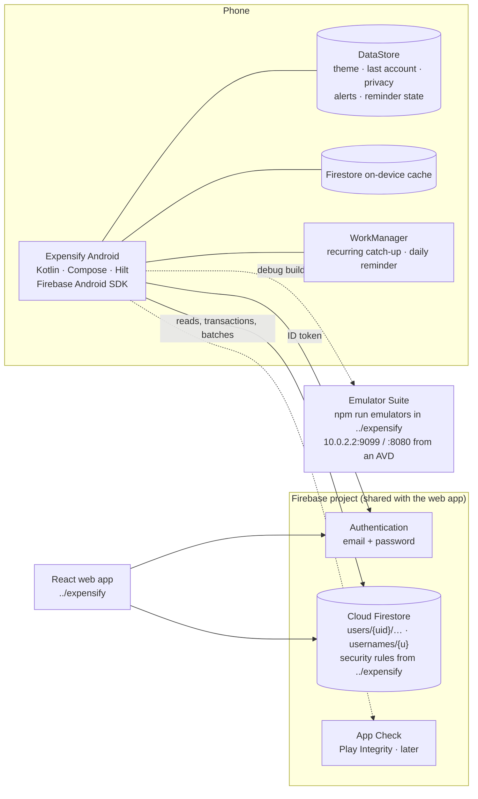
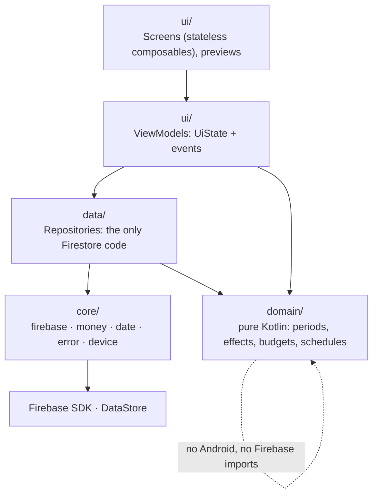
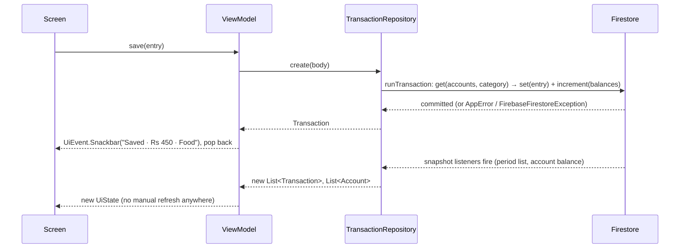
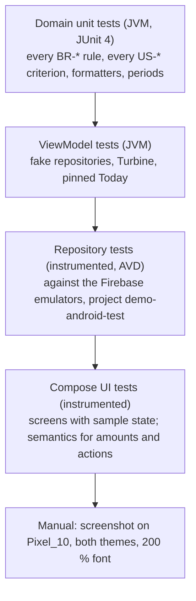

# Expensify for Android — Architecture

Oct 13, 2026 · Companion to [CLAUDE.md](../CLAUDE.md). The functional spec and the data
contract live in the web repo: `../expensify/docs/requirements.md` (cited below as "req §n").

## 1. What shapes the architecture

| Constraint | Consequence |
| --- | --- |
| No backend of our own; Firestore security rules are the only server-side check | The app does everything the web app does in the browser: periods, totals, recurring dates, alerts, and the balance moves inside each write |
| The web repo owns the contract (req §8, §9, `firestore.rules`) | Repositories are a port of the web's `*.api.ts`, field for field. Nothing here invents a document shape |
| Rules check every write field by field (`keys().hasOnly`, `is int`, `is number`) | Explicit write maps and explicit read mappers; no reflection-based `toObject()` |
| Phone first, one-handed, under 5 s to log an expense | Bottom bar + FAB; full-screen entry form with the keypad up; last account remembered on the device |
| The same user may be on web and phone at once | Live snapshot listeners instead of one-shot reads; Firestore transactions guarantee each recurring date is added once across devices |
| Balances must agree with the web to the paisa | Domain logic ported 1:1 from `*.domain.ts` with the same tests; money as `Long` paisa, never floating sums |
| One developer, greenfield | One Gradle module, package-by-feature, few abstractions; split into modules only when build time hurts |

## 2. System context



## 3. Layers and the dependency rule



Dependencies point down only. Concretely:

| Layer | May import | Must not import |
| --- | --- | --- |
| `ui/` screens | Compose, `designsystem`, its feature's `UiState` | ViewModels below screen level, repositories, Firebase |
| `ui/` ViewModels | Repositories (interfaces), `domain`, `core/date`, `core/money`, `core/error` | Compose, Firebase |
| `domain/` | Kotlin stdlib, `java.time`, `core/money`, `core/date` | Android, Firebase, coroutines (pure functions) |
| `data/` repositories | Firebase, `core/firebase`, `domain`, `core/error` | Compose, ViewModels |
| `core/` | Android where unavoidable (`DataStore`, `android.icu`) | Any `feature/*` |

Package-by-feature, one Gradle module. The folder names match the web's `src/features/` so a
reader can open the same feature in both repos.

```
app/src/main/java/<applicationId>/
├── ExpensifyApp.kt · MainActivity.kt
├── core/{firebase,money,date,error,device}
├── designsystem/{theme,icons,components,charts}
├── navigation/{Routes.kt,AppNavHost.kt,BottomBar.kt,MainScaffold.kt}
└── feature/{auth,dashboard,transactions,accounts,categories,budgets,recurring,reports,notifications,settings}/
    ├── data/     XxxRepository (interface) · FirestoreXxxRepository · XxxMappers.kt
    ├── domain/   pure rules, ported from <feature>.domain.ts
    └── ui/       XxxScreen.kt · XxxViewModel.kt · XxxUiState.kt · components/
```

When to split modules: only if a clean build passes ~2 minutes or a second developer joins.
The package layout above already is the module layout (`:core:*`, `:designsystem`,
`:feature:*`), so the split is mechanical later.

## 4. Core building blocks

### 4.1 `core/firebase`

```kotlin
@Module @InstallIn(SingletonComponent::class)
object FirebaseModule {
    @Provides @Singleton fun auth(): FirebaseAuth = Firebase.auth.also { if (BuildConfig.USE_EMULATORS) it.useEmulator("10.0.2.2", 9099) }
    @Provides @Singleton fun firestore(): FirebaseFirestore = Firebase.firestore.also { if (BuildConfig.USE_EMULATORS) it.useEmulator("10.0.2.2", 8080) }
}

/** users/{uid}/… for the logged-in user. Throws AppError.SignedOut when nobody is. */
class UserPaths @Inject constructor(private val auth: FirebaseAuth, private val db: FirebaseFirestore) {
    val uid: String get() = auth.currentUser?.uid ?: throw AppError.SignedOut()
    fun collection(name: UserCollection) = db.collection("users").document(uid).collection(name.path)
    fun document(name: UserCollection, id: String) = collection(name).document(id)
}

enum class UserCollection(val path: String) {   // deletion order (req §9.3)
    Transactions("transactions"), RecurringRules("recurringRules"), Budgets("budgets"), Accounts("accounts"), Categories("categories")
}

const val MAX_BATCH_WRITES = 450
suspend fun FirebaseFirestore.commitInBatches(writes: List<(WriteBatch) -> Unit>)
```

Reading: `Query.snapshots()` (the SDK's Kotlin Flow extension) wrapped so the Flow completes
with `AppError` instead of throwing a `FirebaseFirestoreException`. Writing: `runTransaction`
and `WriteBatch`, awaited with `kotlinx-coroutines-play-services`.

Mapping conventions (one `XxxMappers.kt` per feature):

```kotlin
// Read: DocumentSnapshot.getDouble()/getLong() coerce Firestore's Long↔Double; `get() as Double` does not.
internal fun DocumentSnapshot.toAccount() = Account(
    id = id,
    name = getString("name").orEmpty(),
    type = AccountType.fromStored(getString("type")),
    currency = getString("currency") ?: "NPR",
    openingBalance = Money.fromStored(getDouble("openingBalance") ?: 0.0),
    currentBalance = Money.fromStored(getDouble("currentBalance") ?: 0.0),
    creditLimit = getDouble("creditLimit")?.let(Money::fromStored),
    icon = getString("icon") ?: "wallet", color = getString("color") ?: "#646663",
    includeInTotal = getBoolean("includeInTotal") ?: true, archived = getBoolean("archived") ?: false,
    sortOrder = getLong("sortOrder") ?: 0,
    createdAt = getTimestamp("createdAt", ServerTimestampBehavior.ESTIMATE)?.toInstant() ?: Instant.now(),
    updatedAt = getTimestamp("updatedAt", ServerTimestampBehavior.ESTIMATE)?.toInstant() ?: Instant.now(),
)

// Write: every field the rules list, null when it doesn't apply, whole numbers as Long.
internal fun AccountBody.toFields() = mapOf(
    "name" to name.trim(), "type" to type.stored, "currency" to currency,
    "openingBalance" to openingBalance.toStored(),
    "creditLimit" to creditLimit?.takeIf { type == AccountType.CreditCard }?.toStored(),
    "icon" to icon, "color" to color, "includeInTotal" to includeInTotal,
)
```

### 4.2 `core/money`

```kotlin
/** Exact money in paisa. Stored as a Double with ≤ 2 decimals (req BR-01); summed here as Long. */
@JvmInline value class Money(val paisa: Long) : Comparable<Money> {
    operator fun plus(o: Money) = Money(paisa + o.paisa)
    operator fun minus(o: Money) = Money(paisa - o.paisa)
    operator fun unaryMinus() = Money(-paisa)
    operator fun times(n: Int) = Money(paisa * n)
    fun toStored(): Double = paisa / 100.0
    override fun compareTo(other: Money) = paisa.compareTo(other.paisa)
    companion object { val ZERO = Money(0); fun fromStored(v: Double) = Money((v * 100).roundToLong()) }
}

object MoneyFormat {       // en-IN grouping via android.icu; "Rs 12,34,567.50", "−Rs 450.00", "Rs 1.2L"
    fun full(m: Money, sign: Sign = Sign.Auto): String
    fun compact(m: Money, sign: Sign = Sign.Auto): String
    fun percent(n: Double): String   // whole, half-up (BR-14); callers pass floor for budgets (BR-08)
}
```

Should multi-currency ever arrive, `Money` grows a currency and minor-unit digits; nothing
else changes.

### 4.3 `core/date`

```kotlin
typealias Ymd = String                              // "YYYY-MM-DD", the stored form
data class DateRange(val from: LocalDate, val to: LocalDate)   // both ends included
fun LocalDate.ymd(): Ymd = toString(); fun Ymd.toDate(): LocalDate = LocalDate.parse(this)

object Periods {                                    // BR-06, ported from utils/date.ts
    fun month(d: LocalDate): DateRange; fun week(d: LocalDate): DateRange   // Monday–Sunday
    fun year(d: LocalDate): DateRange; fun lastNMonths(n: Int, today: LocalDate): DateRange
    fun previous(r: DateRange): DateRange
    fun label(r: DateRange): String                 // "September 2026" or "1 Sep – 15 Sep 2026"
}

/** The device's "today", re-read every minute while the app is visible and on every resume. */
@Singleton class Today @Inject constructor(clock: Clock) { val date: StateFlow<LocalDate> }
```

`Today` is injected everywhere "today" matters (ViewModels, runners), so tests pin a date and
midnight rollover is one `StateFlow` emission.

### 4.4 `core/error`

```kotlin
sealed class AppError(message: String) : Exception(message) {
    class WrongPassword(message: String) : AppError(message)
    class Taken(val field: Field, message: String) : AppError(message)   // Username, Email, Name
    class Stale : AppError("Already handled, perhaps on another device")
    class NotFound(message: String) : AppError(message)
    class SignedOut : AppError("You're logged out. Log in again.")
}
object ErrorMessages { fun of(t: Throwable, fallback: String = "Something went wrong"): String }
```

`ErrorMessages.of` maps `FirebaseAuthException.errorCode` and `FirebaseFirestoreException.code`
to the sentences in `../expensify/src/lib/errors.ts`. Firebase's own messages never reach a
screen.

### 4.5 `core/device`

One Preferences DataStore, `device_state`, typed through a `DeviceState` class:

| Key | Holds | Web equivalent |
| --- | --- | --- |
| `theme` | light · dark · system, for the first frame and the login screen | `expensify.theme` |
| `last_account_id` | Account the last entry used (TXN-02) | `expensify.last-account` |
| `privacy` | Dashboard privacy mode (DSH-11) | `expensify.dashboard.privacy.v1` |
| `alerts_json` | The alert list, ≤ 50, ≤ 30 days (NTF-06) | `expensify.alerts.v1` |
| `daily_reminder_last` | Last day the daily reminder fired | `expensify.daily-reminder.v1` |
| `bill_reminders_json` | Recurring reminders already shown, 60 days | `expensify.bill-reminders.v1` |
| `owner_uid` | Whose alert/reminder state this is; a different login clears the three above (NTF-07) | `expensify.notifications-owner.v1` |

## 5. Feature anatomy

Every feature has the same three parts. The repository interface is the web's `*.api.ts`
surface; the domain file is its `*.domain.ts`; the ViewModel is the page component's state.

### 5.1 Repositories (req §9)

| Feature | Interface surface (suspend unless a `Flow`) | Firestore mechanics |
| --- | --- | --- |
| auth | `session: StateFlow<Session>` · `login(usernameOrEmail, password)` · `register(body)` · `profile(): Flow<Profile>` · `updateProfile` · `updatePreferences` · `changeEmail` · `changePassword` · `deleteAccount(password)` · `logout()` | `usernames/{u}` get before login; signup batch (profile + lookup + 25 defaults) with `user.delete()` on failure; re-authenticate before password, email and deletion; `commitInBatches` delete in `UserCollection` order |
| accounts | `accounts(): Flow<List<Account>>` · `account(id): Flow<Account>` · `create` · `update` · `setArchived` · `reconcile(id, actual)` · `delete` | `update` is a transaction: `currentBalance += increment(newOpening − oldOpening)` |
| categories | `categories(): Flow<List<Category>>` · `create` · `update` · `setArchived` · `addDefaults(): Int` · `delete` | Name uniqueness checked in the app (`Taken(Name)`); defaults appended per type |
| transactions | `inRange(range): Flow<List<Transaction>>` · `forAccount(id): Flow<…>` · `ofRule(id): Flow<…>` · `get(id)` · `create(body)` · `update(id, body)` · `delete(id)` · `deleteAll(): Int` | One filter per query; `runTransaction` reads accounts (+ category) then writes entry + `increment()`s; `deleteAll` in batches of `450 − accounts` |
| budgets | `budgets(): Flow<List<Budget>>` · `create` · `update` · `setActive` · `recordAlert(id, periodStart, threshold)` · `delete` | `recordAlert` is a transaction that never lowers the threshold within a period (BR-11) |
| recurring | `rules(): Flow<List<RecurringRule>>` · `create` · `update` · `setActive(id, active, nextDueDate)` · `addOccurrences(id, dates, nextDueDate, entry?)` · `skip(id, nextDueDate)` · `delete` | `addOccurrences`: transaction re-reads the rule, refuses `Stale` on a moved `nextDueDate` or a paused rule, writes ≤ 100 entries + balance moves + `occurrences`/`nextDueDate` |
| reports | none; reports compose `transactions.inRange`, `accounts`, `budgets` | Totals computed in `domain` on `Dispatchers.Default` |

Collection flows for the small collections (profile, accounts, categories, budgets, rules) are
bound to the session and shared app-wide, so every screen sees one listener:

```kotlin
override fun accounts(): Flow<List<Account>> = session.uid
    .flatMapLatest { uid -> if (uid == null) flowOf(emptyList()) else paths.collection(Accounts).snapshots().map { it.toAccounts() } }
    .shareIn(appScope, SharingStarted.WhileSubscribed(5_000), replay = 1)
```

Transactions are **not** shared: each screen listens to its own period, account or rule
(req §9.7), which keeps reads proportional to what is on screen.

### 5.2 Domain (req §4)

Ported function for function from `../expensify/src/features/*/*.domain.ts`, same names,
same tests, plus the acceptance criteria in req §5 as test cases. Highlights:

| File | Holds |
| --- | --- |
| `transactions/domain/BalanceEffects.kt` | `balanceEffects(entry, sign)`, `combineEffects`, `accountIdsOf`, `compareNewestFirst` |
| `transactions/domain/TransactionFilters.kt` | On-device filtering by type, accounts, categories, amount range; word search over note, category, account (LST-02, LST-03) |
| `dashboard/domain/Summary.kt` | Income, expense, net, savings rate, change vs previous period, spending rows with top-5 + Other, 6-period trend |
| `budgets/domain/BudgetProgress.kt` | Spent, % used (floor), state, remaining, days left, safe per day, rollover (BR-07…BR-10), thresholds crossed (BR-11) |
| `recurring/domain/Schedule.kt` | `nextDates(rule, from, limit)`, catch-up dates up to today, end conditions (BR-12, BR-13), resume skipping |
| `accounts/domain/AccountRules.kt` | Liability display ("Owed"/"In credit"), credit used, total balance, balance at end of day D (BR-16, BR-17) |
| `reports/domain/*` | Cash flow by granularity, category comparison, trends table, statements and net worth, budget history |

### 5.3 ViewModels and UI state

```kotlin
sealed interface TransactionsUiState {
    data object Loading : TransactionsUiState
    data class Content(val period: DateRange, val days: List<DayGroup>, val totals: Totals, val filters: Filters, val query: String) : TransactionsUiState
    data class Empty(val period: DateRange, val filtered: Boolean) : TransactionsUiState     // "No matches" vs "No transactions in {period}"
    data class Error(val message: String) : TransactionsUiState
}

@HiltViewModel class TransactionsViewModel @Inject constructor(
    savedState: SavedStateHandle, transactions: TransactionRepository, accounts: AccountRepository,
    categories: CategoryRepository, today: Today,
) : ViewModel() {
    private val route = savedState.toRoute<Routes.Transactions>()
    private val period = MutableStateFlow(route.period(today.date.value))
    private val filters = MutableStateFlow(route.filters())
    private val query = MutableStateFlow("")

    val state: StateFlow<TransactionsUiState> = combine(
        period.flatMapLatest { transactions.inRange(it) }, accounts.accounts(), categories.categories(), filters, query,
    ) { entries, accounts, categories, filters, query -> buildState(...) }     // domain, pure
        .catch { emit(TransactionsUiState.Error(ErrorMessages.of(it))) }
        .stateIn(viewModelScope, SharingStarted.WhileSubscribed(5_000), TransactionsUiState.Loading)

    val events = Channel<UiEvent>(Channel.BUFFERED)     // Snackbar(message), Navigate(route)
}
```

Rules: one `StateFlow<UiState>` per screen; one-shot effects through a `Channel` collected in
a `LaunchedEffect`; route arguments through `SavedStateHandle.toRoute()`; heavy aggregation
(reports over thousands of entries) on `Dispatchers.Default`; state classes are `@Immutable`.

### 5.4 Screens

```kotlin
@Composable fun TransactionsRoute(vm: TransactionsViewModel = hiltViewModel(), onOpen: (String) -> Unit, onAdd: () -> Unit) {
    val state by vm.state.collectAsStateWithLifecycle()
    TransactionsScreen(state, onSearch = vm::search, onFilter = vm::setFilters, onOpen = onOpen, onAdd = onAdd)
}
@Composable fun TransactionsScreen(state: TransactionsUiState, /* callbacks */)   // stateless, previewable
@PreviewLightDark @Composable private fun Preview() = ExpensifyTheme { TransactionsScreen(SampleStates.transactionsContent, …) }
```

A `Route` composable (ViewModel + navigation) wraps a `Screen` composable (state + callbacks).
Only `Screen`s have previews; only `Route`s know the ViewModel.

## 6. Read and write paths



Writes never update local state by hand; the listener does. That is what keeps phone and web
consistent and removes a whole class of "stale after save" bugs.

Offline: Firestore's cache serves listeners, so lists render; `runTransaction` and batches
need the server and fail with the "Can't reach the server" sentence, and the form stays open
(req §16 risks). Plain `update`s (archive, pause, reconcile, preferences) queue and sync later.

## 7. Session and app start

```kotlin
sealed interface Session { data object Unknown : Session; data object SignedOut : Session; data class SignedIn(val uid: String) : Session }
```

- `SessionRepository` turns `FirebaseAuth.AuthStateListener` into `StateFlow<Session>`,
  starting at `Unknown` (the web's `authStateReady()`).
- `MainActivity` keeps the system splash on screen while `Unknown`
  (`splash.setKeepOnScreenCondition`), then `AppNavHost` starts at `Login` or `Home`.
- `SignedIn` → `DeviceState.claim(uid)`: if `owner_uid` differs, clear alerts and reminder
  state (NTF-07); start the app-scoped observers (§9).
- `SignedIn → SignedOut` without `logout()` or `deleteAccount()` having been called (deleted
  login, password changed elsewhere): the shell switches to `AuthNavHost` and shows "Your session
  ended. Log in again." `SessionRepository.expectEnd()` marks the two expected ends.
- Signup: Firebase signs the new login in before its profile exists, so `register` runs inside
  `SessionRepository.holdingSession { }`, which reports `SignedOut` until the batch (profile,
  username lookup, 25 default categories) has landed. Otherwise the dashboard would open, and
  `syncLogin` would write a profile without a username, on a half-made account.
- A profile that doesn't exist (signup batch never landed) is repaired on first load
  exactly as req §9.3 says (`createMissingProfile`), inside `AuthRepository`.
- The `redirect` after login: the route the user tried to open is kept in the `Login`
  route's argument, internal routes only.

## 8. Navigation

Navigation Compose with `@Serializable` routes; one `NavHost` under a `MainScaffold` that
owns the bottom bar and the FAB and hides both on full-screen forms and detail pages.

```kotlin
object Routes {
    @Serializable data class Login(val redirect: String? = null)
    @Serializable data object Signup
    @Serializable data class Home(val period: String? = null, val from: Ymd? = null, val to: Ymd? = null)
    @Serializable data class Transactions(val from: Ymd? = null, val to: Ymd? = null, val type: String? = null, val category: String? = null, val account: String? = null)
    @Serializable data class TransactionDetail(val id: String)
    @Serializable data class EntryForm(val editId: String? = null, val duplicateOf: String? = null, val accountId: String? = null)
    @Serializable data object Accounts;  @Serializable data class AccountDetail(val id: String);  @Serializable data class AccountForm(val id: String? = null)
    @Serializable data object Budgets;   @Serializable data class BudgetDetail(val id: String);   @Serializable data class BudgetForm(val id: String? = null)
    @Serializable data object Recurring; @Serializable data class RuleDetail(val id: String);     @Serializable data class RuleForm(val id: String? = null, val fromTransaction: String? = null)
    @Serializable data object Categories; @Serializable data class CategoryForm(val type: String, val id: String? = null)
    @Serializable data object Reports;   @Serializable data class CashFlow(/* period, by, accounts */); /* CategoryReport, CategoryTrends, AccountsReport, BudgetHistory */
    @Serializable data object More;      @Serializable data object Settings; @Serializable data object Alerts; @Serializable data object ChangePassword
}
```

| Concern | Rule |
| --- | --- |
| Top-level destinations | Home, Transactions, Accounts, Budgets, More: `saveState`/`restoreState` on reselect, single top |
| Drill-downs | Dashboard figures open `Transactions(from, to, type, category)` the way the web's URL does; Back returns to the same dashboard period because it is in `Home`'s arguments |
| Forms | Full-screen destinations; they return through the listener, not a result API. The snackbar after Save is raised by the form's ViewModel before `popBackStack` and shown by the scaffold's host |
| Pickers | `ModalBottomSheet` inside the form screen, not destinations |
| Confirmations | `AlertDialog` driven by ViewModel state (`pendingDelete: Transaction?`) |
| Deep links | `expensify://budgets/{id}`, `expensify://recurring`, `expensify://transactions` are what alerts carry (`AlertLinks`). A system notification opens `MainActivity` (`singleTop`) with the link; the activity parses it and hands an `AlertTarget` to `AlertNavigator`, a buffered channel the signed-in shell collects and navigates on, so a cold start waits for the shell. The snackbar's View and the alerts list go through the same channel |
| Predictive back | `android:enableOnBackInvokedCallback="true"`; no custom back handling except unsaved-form guards |

## 9. Background work and notifications

Mirrors req §12 while the app is open, and adds what a phone can do while it is closed.

| Job | Foreground (app-scoped observer, started on `SignedIn`) | Closed app |
| --- | --- | --- |
| Recurring runner (REC-06) | Observes `rules` + `accounts` + `Today`; for each active auto rule computes due dates ≤ today; calls `addOccurrences` in chunks of 100, oldest first; ignores `Stale` | `RecurringCatchUpWorker`: periodic WorkManager job (daily, flex 1 h, network required) running the same `RecurringService` |
| Budget alerts (NTF-01) | `BudgetAlertsObserver`: observes `budgets` + this period's expenses + `Today`; thresholds crossed → `recordAlert` transaction → `Notifier.deliver` | None (needs the period's entries; evaluated on next open or by the catch-up worker after it adds entries) |
| Bill reminders (NTF-03) | `RecurringRemindersObserver`: observes `rules` + `accounts` + `categories` + `Today`; day-before and waiting reminders, deduplicated in `bill_reminders_json` | `ReminderWorker` (`kind = bills`): daily periodic work first due at the next 09:00, re-aimed on every sign-in and settings change |
| Daily reminder (NTF-02) | `DailyReminderObserver`: a minute tick plus the app coming to the front; one `inRange(today, today)` query while the switch is on; a non-recurring entry counts as logged | `ReminderWorker` (`kind = daily`): daily periodic work first due at the next `reminderTime`; reads today's entries from the server (`fetchInRange`) so a web entry counts |

- `RecurringCatchUp` and `ReminderChecks` (plain classes) hold the logic; the observers and the workers both call them.
- Workers are `@HiltWorker`s; they bail out when `Session` is not `SignedIn`. `ReminderScheduler.sync(prefs)`
  keeps the two reminder jobs in step with the notification settings (NTF-04) and cancels them on sign-out.
- `Notifier.deliver(AlertInput)` (the web's `useNotifier`): adds the alert to `AlertStore`; while the app is on
  screen (`AppVisibility`) shows a long snackbar with a View action, otherwise posts a system notification
  through `SystemNotifier` when the phone allows it (NTF-05). Without permission the bell's badge is the signal.
- Notification channels: `budget_alerts`, `bill_reminders`, `daily_reminder`, created in `ExpensifyApp`;
  `POST_NOTIFICATIONS` requested from the Notifications settings screen, never at launch.
- The in-app alert list (bell on Home → `Routes.Alerts`) is `DeviceState.alerts_json` through `AlertStore`
  (`Flow<List<AppAlert>>`, JSON via kotlinx.serialization), newest first, ≤ 50, ≤ 30 days; `AlertStore.claim(uid)`
  on sign-in clears alerts and reminder state kept for a different user (NTF-07).

## 10. Design system (implementation view)

| Part | Implementation |
| --- | --- |
| Theme | `ExpensifyTheme(theme: ThemePref)` resolves light/dark/system, builds the `ColorScheme` from the token table in CLAUDE.md, provides `LocalExpensifyColors` (income, expense, warn, info, transfer + containers) |
| Type | `ExpensifyTypography` built entirely on `FontFamily.Default`, weights 400/500/700, so OEM custom fonts (HyperOS, One UI, OxygenOS/ColorOS) and the Bold-text setting apply; no font resources in the app. `AmountText` adds `tnum` as an enhancement and right-aligns, never relying on it |
| Icons | `IconMap.of(storedName): ImageVector` over ~55 vector drawables in `res/drawable` (Material Symbols, rounded), with `ic_category` as fallback. Keep `material-icons-extended` out: it is several MB |
| Components | `AmountText(money, kind)`, `EntryRow`, `DayHeader`, `CategoryBadge`, `AccountBadge`, `StatTile`, `ChangeArrow`, `BudgetMeter`, `StateChip`, `PeriodChips`, `FilterChipsRow`, `EmptyState`, `SkeletonRows`, `SectionHeader`, `ConfirmDialog`, `AmountKeypadField` |
| Charts | `DonutChart` and `BarChart` on `Canvas`, with `ChartTable` toggle, accessible labels, privacy masking |
| Previews | `SampleData` object with realistic fixtures; every `Screen` has `@PreviewLightDark` for empty, loading and content |

## 11. Build and configuration

```kotlin
// app/build.gradle.kts (additions)
plugins { alias(libs.plugins.hilt); alias(libs.plugins.ksp); alias(libs.plugins.kotlin.serialization); alias(libs.plugins.google.services) }
android {
    buildFeatures { compose = true; buildConfig = true }
    buildTypes {
        debug   { buildConfigField("boolean", "USE_EMULATORS", (project.findProperty("useEmulators") ?: "true").toString()) }
        release { buildConfigField("boolean", "USE_EMULATORS", "false"); optimization { enable = true } }
    }
}
```

| Item | Plan |
| --- | --- |
| Version catalog additions | `hilt`, `hilt-navigation-compose`, `hilt-work`, `ksp`, `firebase-bom`, `firebase-auth`, `firebase-firestore`, `coroutines-play-services`, `navigation-compose`, `kotlinx-serialization-json`, `lifecycle-viewmodel-compose`, `lifecycle-runtime-compose`, `datastore-preferences`, `work-runtime`, `core-splashscreen`, test: `coroutines-test`, `turbine`, `truth`, `hilt-android-testing` |
| Build types | `debug` points at the emulators unless `-PuseEmulators=false`; `release` never does. No flavors |
| Network security | `src/debug/res/xml/network_security_config.xml` allowing cleartext to `10.0.2.2` only; referenced from the debug manifest |
| Firebase config | `app/google-services.json` (git-ignored) for the final `applicationId`; register `debug` with its own SHA-1 only if Play Integrity is enabled |
| R8 | On in release with keep rules in `src/main/keepRules/`; Firestore and Hilt ship their own rules |
| Lint | `lint { warningsAsErrors = true; abortOnError = true }` once the template is gone |

## 12. Testing



- Repository tests use a secondary `FirebaseApp` initialised with project id
  `demo-android-test` so they never touch the data the web app or the manual build keeps in
  the same emulators (`singleProjectMode` is off in `../expensify/firebase.json`).
- The web's `tests/rules.test.cjs` already proves the rules; Android tests prove the writes
  this app makes pass them, especially whole-number and null-field shapes.
- Balance tests are the priority (req §14): create, edit across accounts, delete, delete all,
  two concurrent `addOccurrences` for the same date.

## 13. Decision log

| Decision | Chosen | Rejected | Why |
| --- | --- | --- | --- |
| Modules | One `:app` module, package-by-feature | Multi-module from day one | One developer; the package layout is already module-shaped for later |
| DI | Hilt ≥ 2.60 + KSP | Koin, manual DI | Standard for Android; Hilt 2.59+ supports AGP 9 (2.58 does not); `@HiltWorker`, `hiltViewModel()` |
| Navigation | Navigation Compose, type-safe routes | Navigation 3, Voyager | Mature, `SavedStateHandle.toRoute()`, deep links for notifications |
| Reads | Snapshot listeners as `Flow` | One-shot `get()` + in-memory cache (what the web does) | Live across devices; no manual refresh after writes |
| Mapping | Explicit mappers and write maps | `toObject<T>()` reflection | The rules reject unknown fields and `2.0` where an int is expected; explicit maps make the shape visible and testable |
| Money | `Money(paisa: Long)` value class | `Double` end to end; `BigDecimal` | Exact sums with zero allocation; stored form stays a Double with ≤ 2 decimals |
| Offline | Firestore cache on (default) | In-memory cache like the web | Lists work offline on a phone; writes that need the server fail with the same message as the web |
| Snapshot filtering | None: every snapshot the SDK raises is emitted | Dropping empty from-cache snapshots so a list never flashes empty before the first server answer | The SDK already withholds the first event while online with an empty cache; the empty from-cache snapshot it does raise (query synced empty before, or client offline) gets no follow-up under `MetadataChanges.EXCLUDE`, so dropping it froze Home and the lists on skeletons (17 October 2026) |
| Reloads | Home and the list keep their last content while the same period loads again; skeletons only the first time a period loads | A skeleton on every reload | Leaving a tab for over 5 s releases its listeners (`WhileSubscribed`); coming back re-attaches them, and the `onStart` "loading" marker would blank a page that has its figures. A new period still starts on skeletons, since the old figures would be wrong under its label (17 October 2026) |
| Forms | Full-screen destinations | Bottom-sheet forms like the web's phone layout | Keyboard + pinned Save + category grid don't fit a sheet; sheets stay for pickers |
| Charts | Compose `Canvas` | Vico, MPAndroidChart | Two chart types, privacy masking and a table toggle are easier in-house |
| Background | WorkManager for catch-up and reminders | Foreground-only like the web | A phone can add the 1st-of-month salary without being opened; same transaction, so safe alongside the web |
| Icons | ~55 vector drawables mapped from lumen names | `material-icons-extended` | APK size; stored names stay lumen's so the web still renders them |
| Font | System default (`FontFamily.Default`) | Bundled Inter, downloadable Google Fonts | Users on Xiaomi, Samsung, OnePlus etc. set a custom system font; only the default family follows it. A bundled font would override their choice |
| Tests | JUnit 4 everywhere | JUnit 5 for JVM | Instrumented tests are JUnit 4; one runner, one style |

## 14. Risks specific to Android

| Risk | Mitigation |
| --- | --- |
| A whole-number field written as `Double` is refused (`PERMISSION_DENIED`) and the message is unhelpful | Mappers write `Long`; repository tests on the emulators for every write; `firestore-debug.log` names the rule |
| Device clock or time zone wrong → entries on the wrong day | Dates are local `YYYY-MM-DD` strings; `Today` is the single source; show the date on the form |
| Cached balances shown briefly after a write from another device | Listeners update within a second online; the account page states "Updated just now" from `updatedAt` |
| Listener read cost: the initial load of a period reads every entry in it | One listener per screen; small collections shared app-wide; no listener on the whole `transactions` collection except Delete all's count |
| Toolchain coupling (AGP 9 ↔ Kotlin 2.2.10 ↔ Hilt ≥ 2.59 ↔ KSP ↔ google-services plugin) | Bump together, in one change, with `assembleDebug` green; verify the google-services plugin version against AGP 9 before adding it |
| WorkManager runs on a dead battery-saver schedule or not at all on some OEMs | The foreground runner still catches up on open, as the web does; workers are a bonus, never the only path |
| App Check with Play Integrity needs Google Play on the device | Off until production; enforcement is a console switch shared with the web |
| A custom OEM font is wider or taller than Roboto, lacks a weight, or ignores `tnum` | Weights limited to 400/500/700; no fixed-height text; amounts right-aligned and columns content-sized; test on a themed Samsung/Xiaomi device, not only the stock AVD |
| Android 17 Local Network Protection drops the app's connections to the emulators at `10.0.2.2` (SYN never answered) | Debug-only `ACCESS_LOCAL_NETWORK` in `src/debug/AndroidManifest.xml`, requested at launch when `USE_EMULATORS` is on, or granted with `adb shell pm grant`; release never needs it |
| Library Kotlin metadata newer than the compiler (BOM 35's `firebase-auth` is built with Kotlin 2.4) fails the whole compile | Pin Firebase BOM 34.x until Kotlin is bumped; use the Java entry points for Auth and Firestore instances |

## 15. Delivery

Phases and "done when" are in CLAUDE.md. The first pull request is phase 0 and nothing else:
final `applicationId`, theme and typography, `IconMap`, the component set with previews, the
scaffold with a bottom bar and placeholder screens, Hilt, Firebase wiring behind
`USE_EMULATORS`, `Money`, `Periods`, `Today`, `AppError` with their unit tests.
